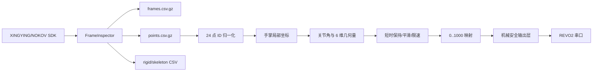
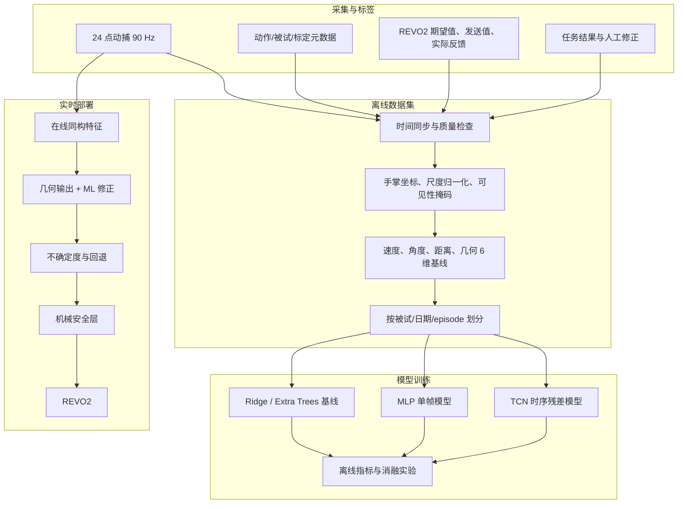

# 手部动捕机器学习训练方案与代码审查

本文面向下一阶段方案评估。当前不实现训练框架，也不改变已经可运行的采集、几何计算和 REVO2 控制逻辑；重点是确认现有代码能提供什么、训练还缺什么，以及后续代码应如何分层。

## 1. 结论

现有项目已经形成了完整的工程基线：

```text
NOKOV/XINGYING 90 Hz 动捕
  -> 24 个已标号反光点
  -> 手掌局部坐标与关节角
  -> 6 维归一化控制量
  -> 短时丢点保持、平滑、限速
  -> 15 Hz REVO2 指令
  -> 限幅、量化、死区和低置信度冻结
```

它适合继续发展为机器学习项目，但目前还不能直接训练出“优于几何算法”的控制模型。最主要原因不是缺少神经网络代码，而是缺少与动捕帧严格同步的 REVO2 目标值、实际反馈、动作标签、采集元数据和训练/测试划分信息。

建议把第一项机器学习任务定义为：

```text
利用 0.2~0.4 秒手部时序数据，预测几何算法需要增加的 6 维修正量，
在不绕过机械安全层的前提下，提高姿态匹配、连续性和丢点鲁棒性。
```

这比直接用动捕点端到端输出电机命令更容易验证，也更适合当前数据和硬件阶段。

## 2. 审查范围

本次检查覆盖：

- `mocap/inspect_mocap.py`：SDK 数据采集、CSV/JSONL 保存和安全关闭；
- `mocap/nokov_ros2_bridge.py`：ROS 2 发布；
- `ml/synthetic_hand_pipeline.py`：24 点合成数据、局部坐标系和几何映射；
- `ml/hand_control_filter.py`：丢点保持、平滑和限速；
- `ml/process_hand_sessions.py`：真实会话离线处理和质量摘要；
- `ml/replay_hand_motion.py`、`ml/demo_hand_pipeline.py`：回放与诊断；
- `revo2/send_positions.py`：REVO2 底层通信；
- `revo2/replay_positions.py`：离线指令回放；
- `revo2/live_mocap_control.py`：实时闭环与机械安全层；
- `tests/`：现有 15 项单元测试的覆盖范围；
- README、数据字段、实时控制和机器学习规划文档。

代码在 Python 3.10 下通过语法编译检查。当前检查机没有安装 `pytest`、NumPy、PyTorch 和项目厂商 SDK，因此本次不能在该环境重新执行完整测试，也不能验证真实 NOKOV/REVO2 硬件行为。

## 3. 当前代码结构



### 3.1 已经做得比较好的部分

- 原始采集和处理结果分开保存，原始数据不被覆盖。
- `sample_index`、SDK 帧号、SDK 时间戳和相对时间均已保存。
- 支持压缩 CSV，避免日常采集默认生成过大的 JSONL。
- 使用手掌局部坐标，几何输出不依赖手在场地中的绝对位置和朝向。
- SDK 回调与 15 Hz 控制循环解耦，只保留最新帧，避免积累控制延迟。
- 实际打开串口必须显式使用 `--enable-hand`。
- 已有最终位置限幅、限跳变、平滑、量化、死区、低置信度冻结和连续发送失败停止。
- 合成数据明确标记为工程测试数据，没有把自生成数据当作人体真值。

## 4. 训练前必须解决的问题

### P0-1：缺少真正的监督标签

当前 `controls_6d.csv` 和 `controls_6d_stable.csv` 都来自同一套几何公式。用这些结果作为唯一标签训练模型，只能逼近已有公式，不能证明模型更准确或更自然。

第一版训练至少需要同步记录：

- 几何算法原始 6 维输出；
- 人工标定或人工修正后的期望 6 维目标；
- 实际发送到 REVO2 的六路指令；
- REVO2 实际位置反馈，如 SDK 支持；
- 指令发送、反馈读取和动捕接收时间；
- 是否完成动作、是否抓取成功以及失败原因。

### P0-2：24 点拓扑和角度范围仍是临时约定

`ml/synthetic_hand_pipeline.py` 中的 Marker 语义、手指长度、最大弯曲角和拇指对掌角来自合成工程模型。真实采集前必须通过贴点说明、实际静态姿态和 REVO2 六通道定义重新确认。

否则模型会在错误的输入语义或错误目标上取得很低的训练误差，但真实控制没有意义。

### P0-3：采集与控制的时间基准没有形成统一数据契约

离线采集的 `elapsed_s` 来自 SDK 时间戳；实时控制的 `elapsed_s` 来自主机 `perf_counter()`。实时 `--record` 目前只保存原始动捕，没有保存控制计算、发送和回读日志，因此无法严格重建：

```text
哪一帧动捕 -> 哪一次模型输出 -> 哪一条串口指令 -> 哪一次实际反馈
```

后续应同时保留 `sdk_timestamp_ms`、`host_receive_ns`、`inference_end_ns`、`send_start_ns`、`send_end_ns` 和 `feedback_ns`，并用单调时钟完成同机对齐。

### P0-4：缺少每通道标定

当前 0~1 到 REVO2 的映射基本是乘以 1000 后使用统一上限。真实机械手需要每通道分别保存：

- 张开零点和安全闭合上限；
- 正反方向；
- 非线性响应曲线；
- 最大速度和单周期最大变化；
- 拇指两个通道之间的耦合限制。

这些参数应进入版本化的校准配置，而不是散落在命令行默认值中。

### P0-5：发送失败后的安全状态需要重新定义

实时安全层在准备发送时就更新了内部“上一输出”。如果串口发送失败，下一帧可能把一条未真正执行的指令当成已执行状态，并因死区而不再发送。后续改造应区分：

```text
candidate_output -> send -> confirmed_output
```

只有发送成功或得到回读确认后，才提交最终输出状态。

## 5. 重要但不阻塞采集的问题

### P1-1：Marker ID 推断需要按会话锁定

离线处理根据整个文件中的 ID 集合推断 `0/24/48/72` 偏移；实时处理每帧都可能重新推断。如果场景中出现额外点、双手或短时只看到部分点，可能发生偏移选择错误。

建议在一次会话开始时使用若干完整帧确定模板和手侧，随后锁定；不满足模板时降低置信度，不在运行中静默切换。

### P1-2：丢点处理只使用最后值保持

当前在最多 0.25 秒内复用最后一次坐标。这对防止突然停止有效，但会让部分骨段“冻结”，在快速动作中产生不真实角度。

训练输入必须包含可见性掩码和点的缺失年龄。后续可比较：线性外推、Kalman 滤波、骨长约束补点和学习式重建，但模型不应把补点值当作真实观测。

### P1-3：局部坐标缺少尺度、手侧和退化检查

当前手掌坐标系由 1、2、3、4 号点直接建立。需要增加：

- 三点接近共线时的退化检测；
- 左右手方向统一；
- 以掌宽或骨长进行尺度归一化；
- 坐标轴突然翻转检测；
- 标定版本与 Marker 布局版本。

### P1-4：Skeleton 相对角目前只有无符号旋转幅值

当前父子骨段处理计算两个四元数之间的最短旋转角，只保留一个非负标量，无法区分屈伸、侧摆和旋转方向。

若后续使用 XINGYING skeleton，应计算 `q_relative = inverse(q_parent) * q_child`，再按约定的局部骨段坐标提取有符号屈伸/外展/扭转角。

### P1-5：质量报告不足以决定一段数据能否训练

现有摘要包含帧数、平均频率、有效帧数、缺点次数和通道最小/平均/最大值。还需要：

- 源帧丢帧率和重复帧率；
- 每个点的可见率、最长连续缺失时长；
- 坐标跳变、速度和加速度异常；
- Marker 身份疑似交换；
- 坐标轴翻转或标定变化；
- 六通道覆盖范围和动作类别分布；
- 标签、命令和反馈的同步误差。

### P1-6：依赖与训练环境需要拆分

当前依赖文件把厂商采集 SDK、REVO2 SDK、科学计算和 Intel XPU 版 PyTorch 放在同一个环境中。训练机不一定连接硬件，也不一定使用 Intel GPU。

建议后续拆成：

```text
requirements-base.txt
requirements-capture-windows.txt
requirements-train-cuda.txt
requirements-dev.txt
```

采集环境保持稳定，训练环境根据训练服务器的 CUDA/PyTorch 组合单独锁定。

### P1-7：现有测试主要证明工程闭环，不证明真实有效性

合成器和几何逆解共享同一套拓扑和角度参数，因此非常低的合成误差主要说明代码闭环一致。后续应增加：

- 经过脱敏的小型真实会话测试样本；
- Marker 丢失、乱序、重复和 ID 偏移测试；
- 时间戳回退、帧丢失和单帧会话测试；
- 每通道校准和左右手测试；
- 发送失败不提交安全状态的测试；
- 特征离线/在线一致性测试；
- 模型输出越界、NaN、超时和回退测试。

## 6. 推荐的训练系统



## 7. 标签设计

### 7.1 标签优先级

从强到弱建议分为：

1. `u_reference`：人工确认的人手姿态对应 REVO2 六维目标；
2. `u_feedback`：机械手实际位置反馈；
3. `u_success`：完成任务时的有效控制轨迹；
4. `u_geometry_corrected`：几何输出经人工修正后的结果；
5. `u_geometry`：几何算法伪标签，只用于预训练或对照。

模型的最终目标不能只来自第 5 类。

### 7.2 推荐学习目标

第一版使用残差学习：

```text
delta_u = u_reference - u_geometry
u_pred   = clamp(u_geometry + delta_u_pred, 0, 1)
```

好处是无数据或模型异常时可以直接回退到几何输出，模型也不需要重新学习手指弯曲的大方向。

### 7.3 标签获取方法

- 静态标定：人手保持姿态，操作员调整 REVO2 到匹配状态并确认六维值；
- 动态标定：先由几何算法驱动，再由操作员对明显偏差做修正；
- 反馈记录：每次发送后读取实际位置，测量响应滞后和跟踪误差；
- 任务标签：记录抓取是否成功、是否滑落、是否碰撞及完成时间；
- 一致性复核：同一姿态重复标定，估计人工标签自身方差。

## 8. Episode 数据规范

建议每次独立动作或任务保存为一个 episode：

```text
episode_000123/
├─ metadata.json
├─ frames.csv.gz
├─ points.csv.gz
├─ skeleton_segments.csv.gz
├─ control_log.csv.gz
├─ events.csv
├─ quality.json
└─ notes.md
```

`metadata.json` 至少包含：

```text
schema_version
episode_id
subject_id                 # 匿名编号
hand_side
session_date
operator_id
action_label
object_id
speed_level
repetition_index
marker_layout_version
xingying_project_version
calibration_id
revo2_device_id
revo2_calibration_version
software_commit
success
failure_reason
```

`control_log.csv.gz` 建议每行记录一次控制周期：

```text
control_index
source_sample_index
sdk_timestamp_ms
host_receive_ns
inference_end_ns
send_start_ns
send_end_ns
feedback_ns
geometry_6d
model_delta_6d
model_output_6d
safe_command_6d
feedback_position_6d
confidence
safety_reason
send_success
```

原始 CSV 适合采集和人工检查。训练前建议转换为 Parquet、NPZ 或其他能高效保存固定时间窗口的格式，但原始文件保持不可变。

## 9. 输入特征

第一版不要只把 72 个世界坐标直接送入网络。推荐输入包括：

- `24 x 3` 手掌局部坐标；
- `24` 维可见性掩码；
- `24` 维缺失持续时间；
- 15 个手指骨段向量及归一化长度；
- MCP/PIP/DIP 和拇指对掌角；
- 指尖到掌心、手腕、相邻指尖的距离；
- 一阶速度和可选二阶差分；
- 几何算法 6 维输出；
- 上一控制周期的命令和实际反馈；
- 手侧、标定版本和必要的个体尺度参数。

建议将 90 Hz 动捕先完成质量处理，再按 30 Hz 构造长度 8~12 帧的窗口，相当于约 0.27~0.4 秒历史。在线仍可按 15~30 Hz 输出控制，不必让模型每个 90 Hz 帧都发送机械指令。

## 10. 模型路线

### 阶段 A：建立可解释基线

- 几何算法；
- 每通道 Ridge 回归；
- Extra Trees 或梯度提升树；
- 单帧小型 MLP。

目的不是追求最高分，而是验证标签是否可学习、哪些特征有效，以及模型是否真的优于几何基线。

### 阶段 B：时序残差模型

首选小型 TCN，备选 GRU。TCN 容易并行训练、推理延迟稳定，也便于限制只使用历史帧。

建议初始规模控制在约 10 万到 100 万参数，不需要大模型。输入最近 8~12 帧，输出当前六维残差和一个置信度。

### 阶段 C：缺点鲁棒性

训练时随机遮挡部分 Marker，但必须同时提供可见性掩码。比较：

- 最后值保持；
- 线性/Kalman 外推；
- 骨长约束补点；
- 模型在缺点输入上的直接预测。

### 阶段 D：跨用户与快速个性化

先训练多人通用模型，再用新用户少量静态标定数据调整最后一层、尺度参数或个体嵌入。不要一开始就把个人模型和通用模型混成一个评价结果。

### 阶段 E：机械臂与视觉任务

只有手部映射和 episode 数据稳定后，再加入相机、机械臂状态和任务动作，考虑行为克隆、ACT 或 Diffusion Policy。这个阶段的数据定义和算力需求与当前 24 点映射不是同一个量级。

## 11. 损失函数建议

第一版时序残差模型可使用：

```text
L = L_position
  + lambda_v * L_velocity
  + lambda_a * L_acceleration
  + lambda_limit * L_out_of_range
  + lambda_conf * L_confidence
```

- `L_position`：六通道 Huber 或 MAE；
- `L_velocity`：约束预测速度与标签速度一致；
- `L_acceleration`：减少不必要的抖动，但权重不能过高以免动作迟钝；
- `L_out_of_range`：惩罚越界；
- `L_confidence`：让模型识别遮挡或分布外输入。

不要只用逐帧 MSE。逐帧误差很低的模型仍可能产生明显抖动、滞后或错误峰值。

## 12. 数据划分和防泄漏

禁止把同一次连续采集的相邻帧随机拆到训练集和测试集。推荐：

- 个人模型：按采集日期和完整 episode 划分；
- 通用模型：保留完全未见过的被试作为测试集；
- 参数调节只看验证集，最终测试集只评估一次；
- 同一个静态保持动作的重复帧不得跨集合；
- 任何归一化统计量只使用训练集计算。

建议至少报告三类结果：

1. `seen subject / unseen session`；
2. `unseen subject`；
3. `marker dropout / fast motion` 压力测试。

## 13. 评估指标

### 离线映射指标

- 六通道 MAE、RMSE、最大误差和 95% 分位误差；
- 动作幅值较小时的死区准确性；
- 速度、加速度和 jerk；
- 相位滞后或时间延迟；
- 每类动作、每个用户和每种速度的分组指标；
- 丢失 1、3、5 个 Marker 以及连续遮挡时的性能下降。

### 实时系统指标

- 特征和模型推理的平均、P95、最大耗时；
- 从动捕接收到命令发送的端到端延迟；
- 每秒实际发送次数和被安全层抑制次数；
- 低置信度冻结、模型回退和串口错误次数；
- 长时间运行中的内存、队列和时间漂移。

### 硬件任务指标

- 静态姿态匹配误差；
- 连续动作平滑度与主观评分；
- 抓取成功率、滑落率和碰撞率；
- 完成时间；
- 同一动作重复执行的一致性。

任何“模型优于几何算法”的结论都应同时满足离线指标和真实机械手任务指标。

## 14. 建议采集方案

### 14.1 第一轮：确认数据和标签

- 1 名被试；
- 10 个静态姿态，每个姿态 5 次，每次保持 3~5 秒；
- 同时完成 REVO2 六通道人工匹配；
- 用于验证时间同步、标定重复性和残差是否可学习。

### 14.2 第二轮：个人动态模型

- 张开、半握、握紧；
- 四指分别弯曲；
- 拇指弯曲和对掌；
- 拇指与食指捏合；
- 连续张合；
- 简单物体抓取。

每个动作建议慢速、正常、快速各采集，合计每类约 20 次，分至少 3 个时间段完成。目标是 100~200 个有效 episode，而不是单纯追求帧数。

### 14.3 第三轮：通用模型

- 8~15 名被试；
- 不同手型和左右手；
- 至少两天重复采集；
- 每名被试保留独立测试 episode；
- 增加掌部朝向变化、快速动作和可控遮挡。

### 14.4 每次采集的质量门槛

以下数值可作为第一版建议阈值，正式阈值应根据真实数据分布调整：

- 目标 Marker 总体可见率不低于 95%；
- 源帧丢失率低于 1%；
- 关键标定姿态中不允许出现长于 0.25 秒的缺点；
- Marker ID 和手侧在整个 episode 内保持一致；
- 控制标签、发送值和反馈均可与源帧关联；
- episode 的动作、速度、标定和成功状态完整填写。

## 15. 训练硬件建议

动捕采集机与模型训练机应分开考虑。当前 24 点时序模型计算量较小，不需要多卡服务器。

### 点位映射与时序模型推荐配置

```text
CPU：12~24 核现代 x86 处理器
内存：64 GB
GPU：NVIDIA，16~24 GB 显存
磁盘：2 TB NVMe，另配数据备份/NAS
系统：Linux 优先，Windows 也可
```

这足够完成树模型、MLP、TCN、GRU、超参数搜索和多人点位数据训练。若只训练第一版小模型，12 GB 显存和 32 GB 内存也能工作，但并行实验和数据缓存余量较小。

### 后续视觉模仿学习推荐配置

```text
CPU：24 核以上
内存：128 GB
GPU：单卡 24~48 GB 显存，或按框架需求使用多卡
磁盘：4 TB 以上高速 NVMe + NAS
```

多路视频通常比 24 点坐标更快占满磁盘和显存。是否购买更高规格硬件，应等相机数量、分辨率、模型类型和训练数据规模确定后再决定。

### 采集机配置重点

采集本身不依赖高端 GPU，更重要的是：

- 稳定的有线网卡和相机网络；
- 稳定的 USB/RS485 串口；
- 16~32 GB 内存；
- 独立 SSD，避免采集期间写入系统盘；
- 系统电源策略、时间同步和后台进程可控。

## 16. 后续代码框架建议

评估通过后，可以按以下顺序补齐代码：

```text
configs/
├─ marker_layout.yaml
├─ revo2_calibration.yaml
├─ dataset.yaml
└─ model.yaml

data_schema/
├─ metadata.schema.json
└─ version.py

ml/
├─ features.py
├─ quality.py
├─ episode.py
├─ build_dataset.py
├─ split_dataset.py
├─ models/
│  ├─ ridge.py
│  ├─ mlp.py
│  └─ tcn.py
├─ train.py
├─ evaluate.py
├─ export.py
└─ inference.py

revo2/
├─ control_logger.py
└─ model_control.py
```

### 推荐实施顺序

1. 定义 schema、metadata 和版本号；
2. 增加同步控制日志和 REVO2 回读；
3. 增加质量报告与 episode 验收；
4. 实现离线/在线共用的特征提取；
5. 建立几何、Ridge 和树模型基线；
6. 实现 TCN 残差模型；
7. 增加模型导出、推理、超时和几何回退；
8. 最后接入实时控制，并保持原机械安全层作为最终边界。

## 17. 第一版验收标准

训练框架开始编写前，建议先确认以下条件：

- 真实 Marker 语义和左右手 ID 规则已经确认；
- REVO2 六通道真实含义、方向和安全范围已经确认；
- 至少完成一组静态人工匹配标签；
- `--record` 能同步保存动捕、控制、发送和反馈；
- 一个 episode 可以由代码自动判定是否合格；
- 训练/验证/测试按 episode 划分；
- 几何基线指标可重复计算；
- 模型不可用、超时、NaN 或低置信度时能够回退到几何输出或冻结输出；
- 模型输出仍然必须经过机械安全层。

完成这些条件后再搭建训练框架，后面的实验结果才具备可解释性和可复现性。
